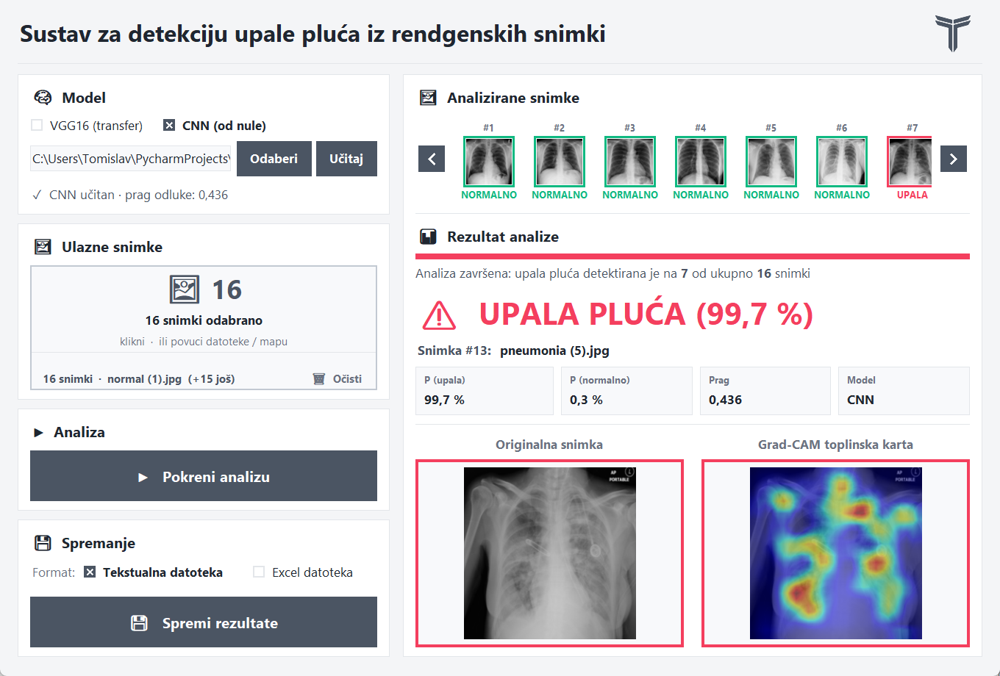
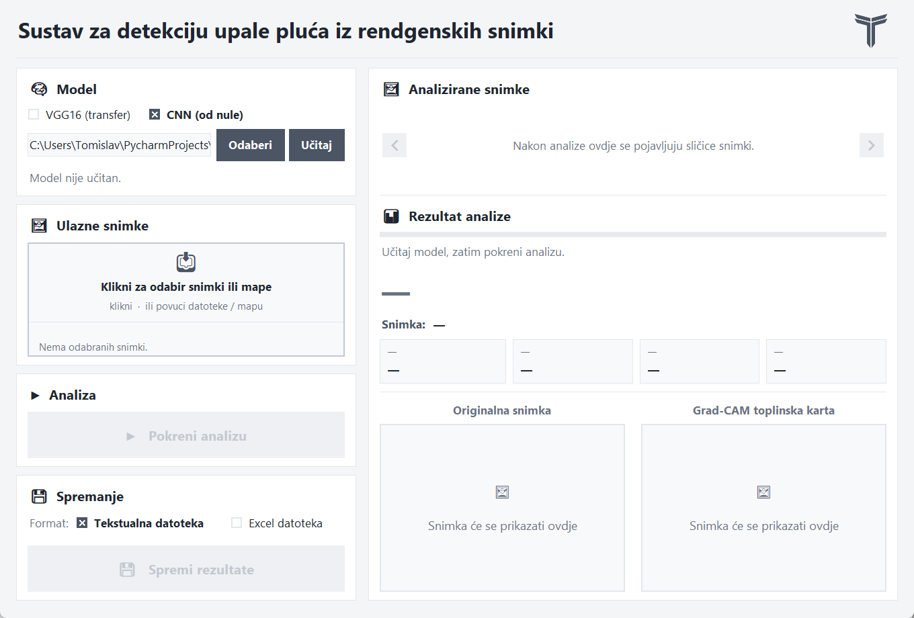
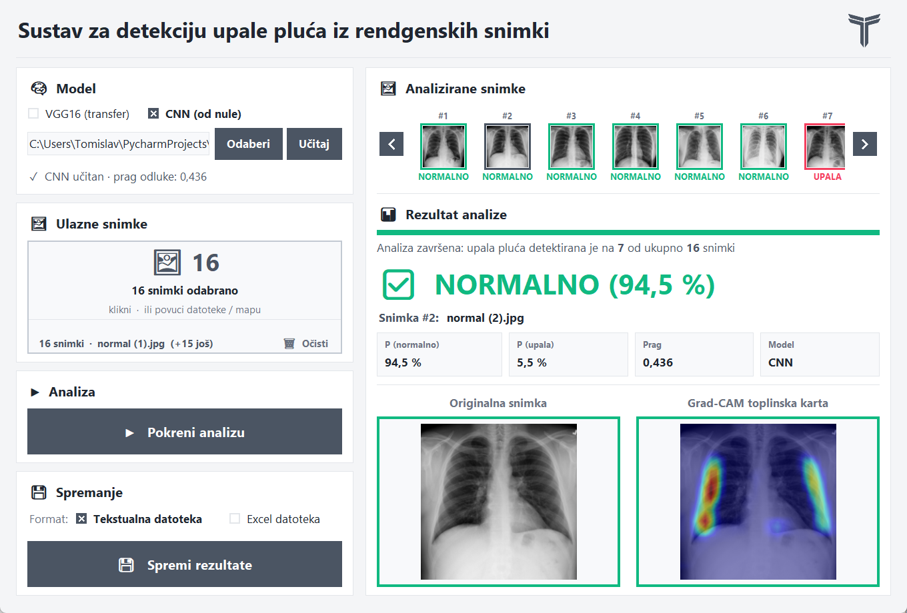

# Sustav za detekciju upale pluća iz rendgenskih snimki

Aplikacija analizira rendgenske snimke prsnog koša i za svaku snimku odlučuje radi li se o **normalnom nalazu** ili o **upali pluća**. Uz odluku prikazuje vjerojatnost i **Grad-CAM toplinsku kartu**, koja pokazuje na koje je dijelove snimke model gledao. Tako se može provjeriti temelji li model odluku na plućnom tkivu ili na nečemu nevažnom, poput ruba slike ili oznake na snimci.

Uspoređena su dva modela dubokog učenja:

- **Vlastita konvolucijska mreža (CNN)** trenirana od nule, s četiri konvolucijska bloka i Squeeze-and-Excitation mehanizmom.
- **VGG16** s prijenosnim učenjem, gdje se mreža prethodno istrenirana na skupu ImageNet prilagođava rendgenskim snimkama.

Projekt je izrađen u sklopu konstrukcijskih vježbi iz kolegija Strojno učenje na Fakultetu elektrotehnike, računarstva i informacijskih tehnologija Osijek. Detaljan opis nalazi se u [projektnoj dokumentaciji](Dokumentacija/Dokumentacija.pdf), a pregled u [prezentaciji](Dokumentacija/Prezentacija.pptx).

> Ovo je studentski projekt i nije medicinski uređaj. Rezultati ne smiju služiti kao zamjena za mišljenje liječnika.



## Sadržaj paketa

```
Kod/                       izvorni kod aplikacije
    main.py                jezgra: konfiguracija, podaci, modeli, Grad-CAM, inferencija, izvještaji, ulazna točka
    gui.py                 grafičko sučelje
    treniranje.py          treniranje modela
    evaluacija.py          metrike, matrica konfuzije, ROC krivulja, usporedba modela
    segmentacija.py        opcionalno izrezivanje područja pluća
    pripremi_rsna.py       priprema RSNA skupa podataka za treniranje
    requirements.txt       popis potrebnih biblioteka
    Assets/                logo aplikacije
    Primjeri_snimki/       16 snimki za isprobavanje (8 normalnih, 8 s upalom pluća)
    Rezultati treniranja/  metrike i grafovi istreniranih modela
Modeli/
    cnn_best.pth           istrenirani vlastiti CNN model (uključen u paket)
Dokumentacija/
    Dokumentacija.pdf      projektna dokumentacija
    Prezentacija.pptx      prezentacija projekta
Slike/                     snimke sučelja korištene u ovom opisu
```

## Što je u paketu, a što nije

**Vlastiti CNN model je uključen** u mapi `Modeli/` i ima oko 5 MB. S njim aplikacija radi odmah nakon preuzimanja, bez treniranja i bez interneta.

**Model VGG16 nije uključen** jer istrenirana datoteka ima oko 530 MB, a GitHub dopušta najviše 100 MB po datoteci. Dobiva se treniranjem na vlastitom računalu (vidi [Treniranje](#treniranje)). Pritom se osnovne ImageNet težine mreže VGG16 **automatski preuzimaju s interneta** pri prvom pokretanju treniranja. Preuzimanje obavlja biblioteka torchvision, a težine se spremaju u lokalnu predmemoriju, pa se preuzimaju samo jednom. Za samu analizu snimki s već istreniranim modelom internet nije potreban.

Skup podataka također nije uključen zbog veličine. Upute za preuzimanje nalaze se u odjeljku [Podaci](#podaci).

## Instalacija

Projekt je razvijan na Windowsu i Pythonu 3.13. Za treniranje se preporučuje NVIDIA grafička kartica, a analiza snimki radi i na procesoru. Sve naredbe se pokreću iz glavne mape paketa.

```bash
python -m venv .venv
.venv\Scripts\activate
pip install torch torchvision --index-url https://download.pytorch.org/whl/cu128
pip install -r Kod/requirements.txt
```

PyTorch se instalira zasebno s CUDA indeksom jer obični `pip install torch` na Windowsu instalira verziju samo za procesor. Za stariji upravljački program grafičke kartice umjesto `cu128` koristi se `cu126`. Na računalu bez NVIDIA kartice dovoljno je `pip install torch torchvision`.

## Korištenje aplikacije

Grafičko sučelje pokreće se naredbom:

```bash
python Kod/main.py
```



Rad s aplikacijom ide u četiri koraka:

1. **Odabir i učitavanje modela.** U dijelu *Model* odabire se CNN ili VGG16 i klikne se *Učitaj*. Ako model VGG16 nije istreniran, aplikacija sama predlaže CNN model iz paketa. Nakon učitavanja ispisuje se prag odluke koji je odabran tijekom treniranja.
2. **Odabir snimki.** Klikom na polje *Ulazne snimke* odabiru se pojedine snimke ili cijela mapa. Snimke se mogu i povući mišem u to polje. Za prvo isprobavanje može se odabrati mapa `Kod/Primjeri_snimki`.
3. **Analiza.** Klik na *Pokreni analizu* obrađuje sve odabrane snimke. Na vrhu se pojavljuju sličice s oznakom NORMALNO ili UPALA, a klikom na sličicu prikazuju se detalji te snimke.
4. **Spremanje.** Rezultati se spremaju kao tekstualna ili Excel datoteka u mapu `Kod/Rezultati/`, zajedno s Grad-CAM slikama svih snimki. Excel izvještaj sadrži i umanjene originalne snimke s toplinskim kartama.

Za svaku snimku prikazuju se konačna odluka, vjerojatnosti obje klase, prag odluke i korišteni model. Crvena boja označava upalu pluća, a zelena normalan nalaz.



## Terminalni način rada

Snimke se mogu analizirati i bez grafičkog sučelja:

```bash
python Kod/main.py cli Kod/Primjeri_snimki --model cnn --spremi xlsx
```

Naredba ispisuje tablicu rezultata u terminalu, a izvještaj i Grad-CAM slike sprema u `Kod/Rezultati/`. Umjesto mape može se navesti jedna ili više pojedinačnih snimki. Opcija `--spremi` prima vrijednosti `txt`, `xlsx` ili `ne`.

## Kako sustav radi

1. **Predobrada.** Snimka se pretvara u sive tonove, skalira na nešto veću dimenziju i izrezuje na središnji dio veličine 224 × 224 piksela. Izrezivanjem se uklanjaju rubovi slike i oznake poput slova „R”, na koje bi se model inače mogao osloniti umjesto na pluća.
2. **Klasifikacija.** Model vraća vjerojatnost da snimka prikazuje upalu pluća.
3. **Odluka.** Vjerojatnost se uspoređuje s pragom odluke. Prag se ne postavlja ručno na 0,5, nego se bira na validacijskom skupu pomoću Youdenova indeksa, uz uvjet da osjetljivost bude najmanje 85 %. Time se smanjuje broj propuštenih upala.
4. **Objašnjenje.** Grad-CAM iz zadnjeg konvolucijskog sloja računa koliko je koje područje snimke pridonijelo odluci i to prikazuje kao toplinsku kartu preko originalne snimke.

Tijekom treniranja koriste se augmentacija (nasumično izrezivanje, zrcaljenje, rotacija, promjena svjetline i kontrasta, brisanje dijelova slike), uravnoteženo uzorkovanje klasa, *dropout* slojevi, regularizacija *weight decay* i rano zaustavljanje. VGG16 se trenira u dvije faze. U prvoj se uči samo novi klasifikacijski sloj, a u drugoj se odmrzava i fino ugađa zadnji konvolucijski blok.

## Rezultati

Rezultati su dobiveni na testnom skupu od 2000 snimki iz RSNA skupa, po 1000 iz svake klase. Testni skup nije korišten ni za treniranje ni za odabir praga.

| Model | Osjetljivost | Specifičnost | Preciznost | F1 | Točnost | ROC-AUC |
|---|---|---|---|---|---|---|
| CNN (vlastiti) | 93,10 % | 87,70 % | 88,33 % | 90,65 % | 90,40 % | 0,9666 |
| VGG16 | 90,00 % | 95,30 % | 95,04 % | 92,45 % | 92,65 % | 0,9743 |

Vlastiti CNN propušta manje upala (veća osjetljivost), dok VGG16 rjeđe proglašava zdrave snimke bolesnima (veća specifičnost) i ima bolju ukupnu točnost.

| | CNN | VGG16 |
|---|---|---|
| Matrica konfuzije |  |  |
| ROC krivulja |  |  |

Grafovi tijeka treniranja i metrike u tekstualnom obliku nalaze se u mapi [Kod/Rezultati treniranja](Kod/Rezultati%20treniranja).

## Ograničenja

Testni skup je uravnotežen, pa su preciznost i točnost veće nego što bi bile uz stvarnu učestalost bolesti. Kategorija „No Lung Opacity / Not Normal” iz RSNA skupa nije korištena, što zadatak čini lakšim od stvarne kliničke situacije. Sustav nije provjeren na snimkama iz drugih bolnica i uređaja.

## Podaci

Korišten je skup [RSNA Pneumonia Detection Challenge](https://www.kaggle.com/c/rsna-pneumonia-detection-challenge) s Kagglea, u verziji sa slikama pretvorenim u JPG. Podaci su potrebni samo za treniranje i evaluaciju, a ne za analizu snimki. Preuzete datoteke treba smjestiti ovako:

```
Kod/Data/
    stage_2_train_images_jpg/
    stage_2_train_labels.csv
    stage_2_detailed_class_info.csv
```

Nakon toga se snimke dijele na skupove za treniranje, validaciju i testiranje:

```bash
python Kod/pripremi_rsna.py
```

Zadano se uzima 2500, 1500 i 1000 snimki po klasi, a rezultat se sprema u `Kod/Data_split/`. Drugačiji broj zadaje se argumentima, na primjer `python Kod/pripremi_rsna.py 3500 500 1000`.

## Treniranje

```bash
python Kod/main.py train cnn
python Kod/main.py train vgg16
python Kod/main.py train oba
```

Nakon treniranja u terminalu se prikazuje pet najboljih epoha prema validacijskom gubitku i bira se koja će se spremiti. Model se sprema u `Modeli/` zajedno s pragom odluke, a grafovi i metrike u `Kod/Rezultati treniranja/`. Pri prvom treniranju modela VGG16 ImageNet težine (oko 530 MB) preuzimaju se automatski.

Usporedba spremljenih modela na testnom skupu pokreće se naredbom:

```bash
python Kod/main.py eval
```

## Autor

Tomislav Perković, FERIT Osijek, 2026.
